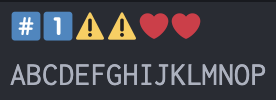
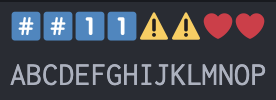
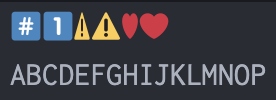
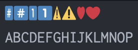

<table>
	<thead>
    	<tr>
      		<th style="text-align:center">日本語</th>
      		<th style="text-align:center"><a href="README_en.md">English</a></th>
    	</tr>
  	</thead>
</table>

# TwemojiTT (TrueType 版 Twemoji)

CJK 等幅フォント用にサイズなどを調整して TrueType に変換した [Twemoji](https://github.com/jdecked/twemoji) です。  
em size = width で line gap = 0 のため、フォールバックフォントに指定した際にレイアウトが崩れにくいと思われます。  
様々な環境に対応できるように CBDT、COLRv0、sbix、OT-SVG の各フォーマットを用意しました。

## バリエーション

### TwemojiTT-*.ttf

- テキストスタイルの #、*、0 〜 9 が不可視のフォントです。
- Unicode の規定に準拠した仕様です。

### TwemojiTTKC-*.ttf

- テキストスタイルの #、*、0 〜 9 がキーキャップと同じグリフで表示されるフォントです。
- ユーザーが扱う際に違和感が少ないと思われる仕様です。

### TwemojiTTTM*-\*.ttf

- ターミナルエミュレータ対応版。
- テキストスタイルの文字幅が Fullwidth、Wide ではない文字のグリフ幅を半分にしています。

  

## ダウンロード

[Releases](https://github.com/omonomo/Twemoji-ttf/releases) からお願いいたします。

[Homebrew](https://brew.sh/ja/) でもインストールできます。[こちら](https://github.com/omonomo/homebrew-tap)をご参照下さい。

フォントやスクリプトの使用は自己責任にてお願いいたします。  
各ファイルを使用することで生じた不具合・損害等について omonomo は責任を負いません。  

## ライセンス

- フォントのライセンスは [CC-BY-4.0 Licensse](https://github.com/omonomo/Twemoji-ttf/blob/main/LICENSE-GRAPHICS.txt) です。
- 素材グラフィックの[ライセンス](https://github.com/jdecked/twemoji/blob/main/LICENSE-GRAPHICS)を継承しています。
- 生成スクリプトのライセンスは [MIT License](https://github.com/omonomo/Twemoji-ttf/blob/main/LICENSE.txt) です。

## 生成スクリプトについて

- 生成には [nanoemoji](https://github.com/googlefonts/nanoemoji) や [FontTools](https://github.com/fonttools/fonttools) を利用しています。  
- 今回は使用していませんが CFF フォーマットにも対応しています ([cffsubr](https://github.com/adobe-type-tools/cffsubr) を利用)。

## メモ

- 生成スクリプト作成に生成 AI を利用しています。
- カラー絵文字は OS やアプリケーションの対応状況がまちまちのため、思い通りに表示されない可能性があります。ご了承願います。

## リンク

自作した改変・合成フォントです。

### 全角英数や半角カナが判別しやすい、文字間隔調整機能付き等幅フォント

- [Cyroit](https://omonomo.github.io/Cyroit/): Inconsolata + Circle M+ 1m + BIZ UDゴシック + NINJAL 変体仮名フォント + Nerd Fonts
- [Idroit](https://omonomo.github.io/Idroit/): Monoid + Cyroit
- [Jeroit](https://omonomo.github.io/Jeroit/): JetBrains Mono + Cyroit
- [Meroit](https://omonomo.github.io/Meroit/): Meslo LG + Hack + Cyroit
- [Roroit](https://omonomo.github.io/Roroit/): Roboto Mono + Noto Sans Mono + Cyroit
- [Soroit](https://omonomo.github.io/Soroit/): Source Code Pro + Hasklig + Cyroit
- [Ubroit](https://omonomo.github.io/Ubroit/): Ubuntu Mono + Cyroit
- [Viroit](https://omonomo.github.io/Viroit/): Victor Mono + Cyroit

### 全角英数や半角カナが判別しやすいプロポーショナルフォント

- [Awroit](https://omonomo.github.io/Awroit/): iA Writer Quattro + IBM Plex Mono + Cyroit

### 開発用途向けにカスタマイズした日本語等幅フォント

- [日本語フォント開発用途化計画](https://github.com/omonomo/JPMonoFonts)
